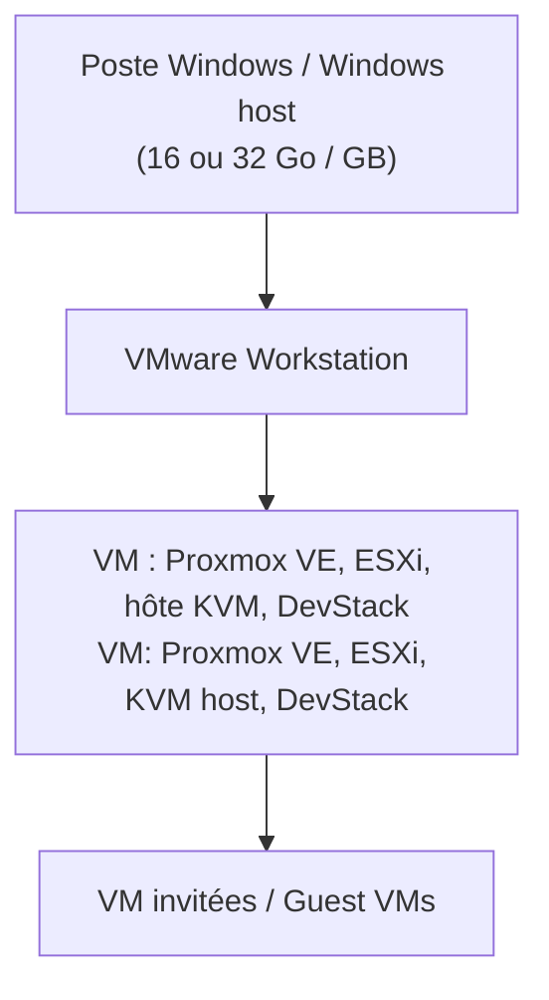
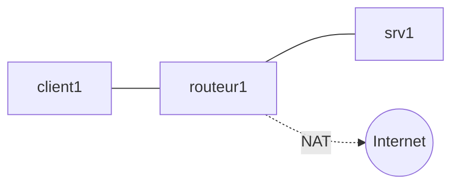
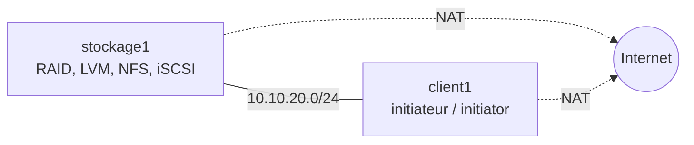

# Environnement de TP / Lab Environment

=== "Français"

    !!! abstract "Objectifs de cette annexe"
        - Choisir le **profil de machine** (A, B ou C) adapté à chaque lab
        - Préparer le poste hôte et éviter les conflits entre hyperviseurs
        - Connaître les outils, leur rôle et le chapitre où ils sont utilisés
        - Appliquer les conventions de réseau et de nommage du cours
        - Valider votre poste **avant** chaque séance

    Tous les labs du cours reposent sur des **machines virtuelles** exécutées sur votre poste. Aucun compte cloud payant n'est nécessaire : les outils sont open source ou utilisés dans leur version ou période d'essai gratuites. Lisez cette page avant le premier lab et revenez-y en cas de problème.

=== "English"

    !!! abstract "Goals of this appendix"
        - Pick the **machine profile** (A, B or C) required by each lab
        - Prepare the host and avoid hypervisor conflicts
        - Know the tools, their role and the chapter where they are used
        - Apply the course networking and naming conventions
        - Validate your machine **before** each session

    All labs run on **virtual machines** hosted on your own computer. No paid cloud account is required: tools are open source or used through their free edition or trial period. Read this page before the first lab and come back to it when something goes wrong.

## 1. Profils de machine / Machine profiles

=== "Français"

    Le cours prévoit trois profils. Chaque fiche de lab indique le profil requis et les ressources minimales de ses machines virtuelles.

    - **Profil A** : poste de 16 Go de RAM. Il couvre la majorité des labs (Parties 1 et 2, KVM, Infrastructure as Code, LocalStack, supervision).
    - **Profil B** : poste de 16 Go de RAM dont **8 Go** peuvent être dédiés à une seule machine virtuelle (Proxmox VE, ESXi). Les autres applications doivent être fermées pendant le lab.
    - **Profil C** : poste de **32 Go** de RAM, ou machine de salle. Il est requis pour les grappes à plusieurs nœuds, vCenter, Ceph et DevStack. Si vous n'y avez pas accès, le lab est réalisé en démonstration ou sur une machine partagée (voir la section 9).

    !!! info "Mémoire réservée à l'hôte"
        Prévoyez environ **4 Go** pour Windows et l'hyperviseur. La RAM disponible pour les machines virtuelles est donc d'environ 12 Go sur un poste de 16 Go. Cette valeur est une estimation de départ, à confirmer sur vos postes.

=== "English"

    The course defines three profiles. Each lab sheet states the profile it requires and the minimum resources of its virtual machines.

    - **Profile A**: a 16 GB RAM computer. It covers most labs (Parts 1 and 2, KVM, Infrastructure as Code, LocalStack, monitoring).
    - **Profile B**: a 16 GB RAM computer where **8 GB** can be dedicated to a single virtual machine (Proxmox VE, ESXi). Close other applications during the lab.
    - **Profile C**: a **32 GB** RAM computer, or a classroom machine. It is required for multi-node clusters, vCenter, Ceph and DevStack. If you cannot access one, the lab is done as a demonstration or on a shared machine (see section 9).

    !!! info "Memory reserved for the host"
        Plan for about **4 GB** for Windows and the hypervisor. On a 16 GB computer, roughly 12 GB remain for virtual machines. This is a starting estimate, to be confirmed on your machines.

| Profil / Profile | RAM hôte / Host RAM | vCPU (cœurs) / Cores | Disque libre / Free disk | Usage principal / Main use |
|---|---|---|---|---|
| **A** | 16 Go / GB | 4 minimum | 100 Go / GB | Parties 1 et 2, KVM, IaC, LocalStack, supervision |
| **B** | 16 Go / GB (8 Go / GB pour une VM) | 4 minimum | 100 Go / GB | Proxmox VE (un nœud), ESXi |
| **C** | 32 Go / GB | 6 recommandés / recommended | 200 Go / GB (estimation / estimate) | Cluster Proxmox, vCenter, Ceph, DevStack |

### Budget de mémoire par groupe de labs / Memory budget per lab group

| Labs | Machines simultanées / Concurrent VMs | RAM VM totale / Total VM RAM | Profil |
|---|---|---|---|
| 3.1 à 4.2 (hyperviseurs de poste) | 1 | 2 Go / GB | A |
| 5.1 à 6.3 (réseau, Vagrant) | 3 | 3 Go / GB | A |
| 7.1 à 9.3 (disques, RAID, LVM, ZFS) | 1 | 2 à 4 Go / GB | A |
| 10.1 à 10.3 (NFS, iSCSI, multipath) | 2 | 2 Go / GB | A |
| 11.1 (MinIO) | 1 | 2 Go / GB | A |
| 11.2 (Ceph) | 3 | 12 Go / GB | C |
| 12.1 à 12.3 (KVM) | 1 hôte KVM + invités légers / light guests | 4 Go / GB | A |
| 13.1 à 13.3, 17.2 (Proxmox VE, un nœud / single node) | 1 | 8 Go / GB | B |
| 14.1 à 14.3 (cluster Proxmox VE) | 2 | 12 Go / GB | C (ou / or 2 × 6 Go / GB, limite / tight) |
| 15.1 à 15.3 (ESXi) | 1 ESXi + 1 stockage / storage | 9 Go / GB | B |
| 16.1 à 16.3 (vCenter) | 1 vCenter + 2 ESXi | à confirmer / to be confirmed | C |
| 18.1 à 19.3 (DevStack) | 1 | 12 Go / GB | C |
| 20.1, 21.1, 22.1 à 22.2 (IaC, LocalStack, supervision) | 1 à 2 | 4 Go / GB | A |

!!! warning "À tester avant la séance / To test before the session"
    La mémoire de la plus petite taille de vCenter (environ 14 Go d'après la documentation de l'éditeur) et la faisabilité d'un cluster Proxmox VE avec deux VM de 6 Go sur un poste de 16 Go sont à valider sur le matériel réel. / The memory of the smallest vCenter size (about 14 GB according to the vendor documentation) and the feasibility of a two-VM Proxmox VE cluster at 6 GB each on a 16 GB computer must be validated on real hardware.

## 2. Poste hôte / Host computer

=== "Français"

    ### Système et BIOS

    - Système hôte de référence : **Windows 10 ou 11** (64 bits).
    - La **virtualisation matérielle** (Intel VT-x ou AMD-V) doit être activée dans le BIOS ou l'UEFI. Le lab 2.1 vous guide pour la vérifier.
    - **Hyper-V** (chapitre 4) n'est disponible que sous les éditions **Pro, Entreprise et Éducation** de Windows. Sous l'édition Famille, ce chapitre est suivi en démonstration ou sur un poste de salle.

    ### Hyperviseurs de poste

    | Outil | Rôle dans le cours |
    |---|---|
    | VMware Workstation | Hyperviseur principal : il héberge les machines imbriquées (Proxmox VE, ESXi, KVM) |
    | VirtualBox | Alternative libre, comparée à VMware Workstation au chapitre 3 |
    | Hyper-V | Hyperviseur intégré à Windows, étudié au chapitre 4 |

    ### Un seul hyperviseur actif à la fois

    Hyper-V, la Plateforme de l'hyperviseur Windows, la Plateforme de machine virtuelle, WSL 2 et l'intégrité de la mémoire (isolation du noyau) activent l'hyperviseur de Windows. VMware Workstation et VirtualBox peuvent alors fonctionner par-dessus, avec des performances réduites et, selon les cas, sans virtualisation imbriquée. **Pour les labs de la Partie 3 (Proxmox VE, ESXi, KVM), travaillez avec l'hyperviseur de Windows désactivé.**

    Pour basculer, ouvrez PowerShell **en administrateur**, puis redémarrez :

    ```powershell
    bcdedit /set hypervisorlaunchtype off    # pour VMware Workstation et VirtualBox
    bcdedit /set hypervisorlaunchtype auto   # pour revenir à Hyper-V
    ```

    !!! warning "À tester"
        Le comportement exact dépend de la version de Windows, de VMware Workstation et de VirtualBox. Testez le basculement sur votre poste avant la séance du chapitre 4.

=== "English"

    ### System and BIOS

    - Reference host system: **Windows 10 or 11** (64-bit).
    - **Hardware virtualization** (Intel VT-x or AMD-V) must be enabled in the BIOS or UEFI. Lab 2.1 guides you through checking it.
    - **Hyper-V** (chapter 4) is only available on the **Pro, Enterprise and Education** editions of Windows. On the Home edition, this chapter is followed as a demonstration or on a classroom machine.

    ### Desktop hypervisors

    | Tool | Role in the course |
    |---|---|
    | VMware Workstation | Main hypervisor: it hosts the nested machines (Proxmox VE, ESXi, KVM) |
    | VirtualBox | Open-source alternative, compared with VMware Workstation in chapter 3 |
    | Hyper-V | Hypervisor built into Windows, studied in chapter 4 |

    ### Only one active hypervisor at a time

    Hyper-V, the Windows Hypervisor Platform, the Virtual Machine Platform, WSL 2 and memory integrity (core isolation) start the Windows hypervisor. VMware Workstation and VirtualBox can then run on top of it, with reduced performance and, in some cases, without nested virtualization. **For the Part 3 labs (Proxmox VE, ESXi, KVM), work with the Windows hypervisor turned off.**

    To switch, open PowerShell **as administrator**, then reboot:

    ```powershell
    bcdedit /set hypervisorlaunchtype off    # for VMware Workstation and VirtualBox
    bcdedit /set hypervisorlaunchtype auto   # to go back to Hyper-V
    ```

    !!! warning "To test"
        The exact behavior depends on your Windows, VMware Workstation and VirtualBox versions. Test the switch on your machine before the chapter 4 session.

## 3. Outils du cours / Course tools

Les **versions exactes** sont fixées et testées dans la fiche de chaque lab. / The **exact versions** are fixed and tested in each lab sheet.

| Outil / Tool | Rôle / Role | Chapitres / Chapters | Licence ou accès / License or access |
|---|---|---|---|
| Ubuntu Server 24.04 LTS | Système invité de référence / reference guest OS | Tous / All | Open source |
| VMware Workstation | Hyperviseur de poste / desktop hypervisor | 2 à 6, Partie 3 / Part 3 | Gratuit, conditions à vérifier / free, terms to check |
| VirtualBox | Hyperviseur de poste / desktop hypervisor | 3, 5, 6 | Open source |
| Hyper-V | Hyperviseur Windows / Windows hypervisor | 4, 5, 6 | Inclus dans Windows Pro et supérieur / included in Windows Pro and above |
| Vagrant | Description d'environnements / environment description | 6 | Gratuit, licence BSL / free, BSL license |
| KVM, QEMU, libvirt | Hyperviseur Linux / Linux hypervisor | 7, 12, 20 | Open source |
| mdadm, LVM, OpenZFS, fio | Disques et performances / disks and performance | 7 à 9 | Open source |
| NFS, Samba, targetcli, open-iscsi | Stockage en réseau / network storage | 10 | Open source |
| MinIO, Ceph | Stockage objet et défini par logiciel / object and software-defined storage | 11 | Open source ; distribution communautaire de MinIO à vérifier / MinIO community distribution to check |
| Proxmox VE | Plateforme de virtualisation / virtualization platform | 13, 14, 17 | Open source (voir l'avertissement d'abonnement, section 8 / see the subscription notice, section 8) |
| VMware ESXi | Hyperviseur de type 1 / type 1 hypervisor | 15 | Édition gratuite, conditions à vérifier / free edition, terms to check |
| VMware vCenter | Gestion centralisée / central management | 16 | Essai de 60 jours / 60-day trial |
| DevStack (OpenStack) | Cloud privé / private cloud | 18, 19 | Open source |
| OpenTofu, Ansible | Infrastructure as Code | 20 | Open source |
| LocalStack (édition communautaire / community edition) | Simulation locale de services AWS / local AWS service emulation | 21 | Gratuit, fonctions limitées / free, limited features |
| Prometheus, Grafana, restic | Supervision et sauvegarde / monitoring and backup | 22 | Open source |

## 4. Plan d'adressage et conventions / Addressing plan and conventions

=== "Français"

    Pour que les labs soient comparables d'un poste à l'autre, le cours utilise les **plages de référence** suivantes. Ce sont des conventions du cours, pas des valeurs par défaut des outils.

    | Réseau | Rôle | Plage de référence |
    |---|---|---|
    | Gestion | Administration des machines | `10.10.10.0/24` |
    | Stockage | Trafic NFS, iSCSI, Ceph | `10.10.20.0/24` |
    | Données | Trafic applicatif, VLAN de test | `10.10.30.0/24` |
    | Cloud | Réseau des instances OpenStack | `10.10.40.0/24` |

    - **Accès Internet** : chaque machine dispose d'une carte en mode **NAT** pour installer les paquets. Les réseaux internes ou « hôte seul » servent aux échanges entre machines.
    - **Nommage** : `<rôle><numéro>`, par exemple `srv1`, `routeur1`, `stockage1`, `pve1`, `esxi1`.
    - **Utilisateur** : un compte non administrateur avec `sudo`, et des mots de passe de TP **jamais réutilisés** ailleurs.

=== "English"

    So that labs are comparable from one computer to another, the course uses the following **reference ranges**. They are course conventions, not tool defaults.

    | Network | Role | Reference range |
    |---|---|---|
    | Management | Machine administration | `10.10.10.0/24` |
    | Storage | NFS, iSCSI, Ceph traffic | `10.10.20.0/24` |
    | Data | Application traffic, test VLANs | `10.10.30.0/24` |
    | Cloud | OpenStack instance network | `10.10.40.0/24` |

    - **Internet access**: each machine has a **NAT** adapter to install packages. Internal or "host-only" networks carry traffic between machines.
    - **Naming**: `<role><number>`, for example `srv1`, `routeur1`, `stockage1`, `pve1`, `esxi1`.
    - **User**: a non-administrator account with `sudo`, and lab passwords that are **never reused** elsewhere.

## 5. Topologies de référence / Reference topologies

### Virtualisation imbriquée / Nested virtualization

Les Parties 3 et 4 empilent plusieurs couches de virtualisation. Chaque couche supplémentaire ralentit les machines : soyez patients au démarrage. / Parts 3 and 4 stack several virtualization layers. Each extra layer slows machines down: be patient at boot time.



### Laboratoire réseau (Partie 1) / Network lab (Part 1)



### Laboratoire de stockage (Partie 2) / Storage lab (Part 2)



## 6. Test de validation avant la séance / Pre-session check

=== "Français"

    Réalisez ce contrôle la veille, jamais le jour même. Chaque case doit être cochée.

    - [ ] La virtualisation matérielle est active (voir les commandes ci-dessous)
    - [ ] Vous disposez de la RAM et de l'espace disque du profil requis
    - [ ] Une machine Ubuntu Server démarre et accède à Internet
    - [ ] Un **snapshot « etat-propre »** existe pour chaque machine du lab
    - [ ] Les images ISO et les boîtes nécessaires sont téléchargées avant d'arriver en salle

    Sous **Windows** (PowerShell) :

    ```powershell
    systeminfo | Select-String "Hyper-V"     # section « Configuration requise pour Hyper-V »
    ```

    Dans une machine **Linux** :

    ```bash
    nproc                                     # nombre de vCPU
    free -h                                   # mémoire disponible
    df -h /                                   # espace disque
    lscpu | grep -i virtualization            # extension VT-x ou AMD-V visible
    egrep -c '(vmx|svm)' /proc/cpuinfo        # doit afficher un nombre supérieur à 0
    sudo apt install -y cpu-checker && kvm-ok # KVM utilisable (labs de la Partie 3)
    ping -c 2 8.8.8.8                         # accès réseau
    curl -sI https://archive.ubuntu.com | head -1   # accès aux dépôts
    ```

=== "English"

    Run this check the day before, never on the day itself. Every box must be ticked.

    - [ ] Hardware virtualization is active (see the commands below)
    - [ ] You have the RAM and disk space of the required profile
    - [ ] An Ubuntu Server machine boots and reaches the Internet
    - [ ] A **"clean-state" snapshot** exists for every machine of the lab
    - [ ] The required ISO images and boxes are downloaded before you arrive in class

    On **Windows** (PowerShell):

    ```powershell
    systeminfo | Select-String "Hyper-V"     # "Hyper-V Requirements" section
    ```

    In a **Linux** machine:

    ```bash
    nproc                                     # number of vCPUs
    free -h                                   # available memory
    df -h /                                   # disk space
    lscpu | grep -i virtualization            # VT-x or AMD-V extension visible
    egrep -c '(vmx|svm)' /proc/cpuinfo        # must print a number greater than 0
    sudo apt install -y cpu-checker && kvm-ok # KVM usable (Part 3 labs)
    ping -c 2 8.8.8.8                         # network access
    curl -sI https://archive.ubuntu.com | head -1   # repository access
    ```

!!! tip "Virtualisation imbriquée / Nested virtualization"
    Pour exposer la virtualisation matérielle à une machine invitée : cochez l'option correspondante dans les paramètres de la VM sous VMware Workstation ; `VBoxManage modifyvm <nom> --nested-hw-virt on` sous VirtualBox ; `Set-VMProcessor -VMName <nom> -ExposeVirtualizationExtensions $true` sous Hyper-V (PowerShell en administrateur, VM éteinte). Chaque procédure est détaillée et testée dans les labs concernés. / To expose hardware virtualization to a guest: tick the matching option in the VM settings on VMware Workstation; `VBoxManage modifyvm <name> --nested-hw-virt on` on VirtualBox; `Set-VMProcessor -VMName <name> -ExposeVirtualizationExtensions $true` on Hyper-V (PowerShell as administrator, VM powered off). Each procedure is detailed and tested in the relevant labs.

## 7. Snapshots et reprise à zéro / Snapshots and reset

=== "Français"

    - Avant chaque séance, **restaurez** le snapshot `etat-propre` de vos machines pour partir d'une base saine.
    - Après une installation réussie (système installé, mises à jour faites, accès réseau validé), **créez** ce snapshot.
    - Un snapshot n'est **pas une sauvegarde** : il dépend du disque d'origine. Conservez aussi vos fichiers de configuration (Vagrantfile, manifestes, scripts) dans un dépôt Git.
    - Si un lab échoue de façon inexplicable, restaurer le snapshot et recommencer est souvent plus rapide que diagnostiquer.

=== "English"

    - Before each session, **restore** the `etat-propre` snapshot of your machines to start from a clean base.
    - After a successful installation (system installed, updates applied, network validated), **create** that snapshot.
    - A snapshot is **not a backup**: it depends on the original disk. Also keep your configuration files (Vagrantfile, manifests, scripts) in a Git repository.
    - When a lab fails for no obvious reason, restoring the snapshot and starting over is often faster than troubleshooting.

## 8. Précautions : licences, essais et accès / Precautions: licenses, trials and access

=== "Français"

    - **Essai de vCenter (60 jours)** : la période démarre à l'installation. N'installez vCenter qu'au chapitre 16, pas avant.
    - **ESXi et VMware Workstation** : les conditions de téléchargement et de licence de l'éditeur évoluent, et un compte chez l'éditeur peut être demandé. Téléchargez les installateurs bien avant la séance.
    - **Proxmox VE** : une fenêtre signale l'absence d'abonnement à chaque connexion. Elle n'empêche pas d'utiliser la plateforme pour les labs.
    - **Vagrant** : distribué sous licence BSL ; l'usage pédagogique ne pose pas de difficulté, mais ce n'est pas une licence open source classique.
    - **Cloud public** : le cours n'exige aucun compte. Les offres gratuites et les crédits d'essai des fournisseurs changent souvent et demandent généralement une carte bancaire : seules des démonstrations et des simulations locales sont prévues.
    - **Secrets** : jetons, mots de passe et clés de TP ne sont jamais publiés dans un dépôt public.

=== "English"

    - **vCenter trial (60 days)**: the period starts at installation. Do not install vCenter before chapter 16.
    - **ESXi and VMware Workstation**: the vendor's download and licensing terms change, and a vendor account may be required. Download the installers well before the session.
    - **Proxmox VE**: a dialog reports the missing subscription at each login. It does not prevent you from using the platform for labs.
    - **Vagrant**: distributed under the BSL license; educational use is not a problem, but it is not a classic open-source license.
    - **Public cloud**: the course requires no account. Providers' free tiers and trial credits change often and usually require a credit card: only demonstrations and local simulations are planned.
    - **Secrets**: tokens, passwords and lab keys are never published in a public repository.

## 9. Si les ressources manquent / If resources are missing

=== "Français"

    | Situation | Solution prévue |
    |---|---|
    | Poste de 16 Go pour un lab de profil C | Travail en binôme sur une machine de 32 Go, ou démonstration enseignante |
    | Édition Famille de Windows (chapitre 4) | Démonstration ou poste de salle compatible Hyper-V |
    | Pas d'accès à l'éditeur pour ESXi ou vCenter | Installateurs fournis par l'enseignant pendant la séance |
    | Disque insuffisant | Disques virtuels à allocation dynamique, suppression des machines du chapitre précédent après sauvegarde de vos fichiers |

=== "English"

    | Situation | Planned solution |
    |---|---|
    | 16 GB computer for a profile C lab | Pair work on a 32 GB machine, or instructor demonstration |
    | Windows Home edition (chapter 4) | Demonstration or a classroom machine that supports Hyper-V |
    | No access to the vendor site for ESXi or vCenter | Installers provided by the instructor during the session |
    | Insufficient disk space | Thin-provisioned virtual disks, delete the previous chapter's machines after saving your files |

## 10. Dépannage / Troubleshooting

| Symptôme / Symptom | Pistes / Hints |
|---|---|
| `kvm-ok` indique que KVM ne peut pas être utilisé / `kvm-ok` says KVM cannot be used | Virtualisation imbriquée non exposée à la VM, ou hyperviseur Windows actif / nested virtualization not exposed to the VM, or Windows hypervisor active |
| La VM est très lente ou ne démarre pas / The VM is very slow or does not start | RAM insuffisante pour l'hôte, ou conflit entre hyperviseurs ; fermer les autres applications, vérifier `hypervisorlaunchtype` / not enough host RAM, or hypervisor conflict; close other applications, check `hypervisorlaunchtype` |
| Pas d'accès Internet depuis la VM / No Internet access from the VM | Vérifier la carte NAT, la passerelle et le DNS (`ip route`, `resolvectl status`) / check the NAT adapter, gateway and DNS |
| Deux machines ont la même adresse / Two machines share an address | Adresses fixes en conflit ou clones non réinitialisés ; changer l'adresse et l'identifiant de machine / conflicting static addresses or clones not reset; change the address and machine ID |
| Disque plein sur l'hôte / Host disk full | Supprimer snapshots et machines inutiles, compacter les disques virtuels / delete unused snapshots and machines, compact virtual disks |
| `curl` se comporte étrangement sous PowerShell / `curl` behaves oddly in PowerShell | Utiliser `curl.exe` et non l'alias PowerShell / use `curl.exe`, not the PowerShell alias |
| Modification du fichier `hosts` refusée / `hosts` file edit refused | Ouvrir l'éditeur en administrateur / open the editor as administrator |

## Voir aussi / See also

- [Lab 2.1 : Préparer le poste pour la virtualisation](../partie-1-datacenter-et-virtualisation-sur-poste-de-travail/ch02-principes-de-la-virtualisation/lab-2-1-preparer-le-poste-pour-la-virtualisation.md)
- [Chapitre 4 : Hyper-V](../partie-1-datacenter-et-virtualisation-sur-poste-de-travail/ch04-hyper-v/cours.md)
- [Lab 11.2 : Grappe Ceph à trois nœuds](../partie-2-virtualisation-du-stockage/ch11-stockage-defini-par-logiciel/lab-11-2-grappe-ceph-a-trois-nuds.md)
- [Lab 14.1 : Constituer un cluster Proxmox VE](../partie-3-hyperviseurs-serveur-et-plateformes-d-entreprise/ch14-proxmox-ve-cluster-et-haute-disponibilite/lab-14-1-constituer-un-cluster-proxmox-ve.md)
- [Lab 15.1 : Installer ESXi gratuit en VM imbriquée](../partie-3-hyperviseurs-serveur-et-plateformes-d-entreprise/ch15-vmware-vsphere-1-concepts-et-esxi-gratuit/lab-15-1-installer-esxi-gratuit-en-vm-imbriquee.md)
- [Lab 16.1 : Déployer vCenter](../partie-3-hyperviseurs-serveur-et-plateformes-d-entreprise/ch16-vmware-vsphere-2-vcenter-et-fonctions-avancees/lab-16-1-deployer-vcenter.md)
- [Lab 18.1 : Installer DevStack](../partie-4-cloud-prive-infrastructure-as-code-et-cloud-public/ch18-openstack-architecture-et-services/lab-18-1-installer-devstack.md)